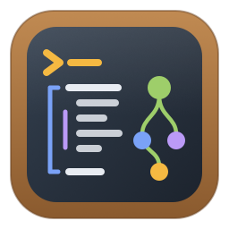

```
   _._
 o|- -|o This file is licensed under CC BY-NC-SA 4.0 international license.
  ( l )  To view a copy of this license, visit http://creativecommons.org/licenses/by-nc-sa/4.0/
    =    Author: jean-marc "jihem" quere 2026
```

[](https://lipunila.sonaliwan.fr)
# Ardoise - éditeur multi-usage écrit en Lexis+

Ardoise est un éditeur de texte et de code **sans menu** : toutes les actions passent par
une **palette de commandes**, que des **extensions** écrites en Lexis+ enrichissent. Il
reprend l'éditeur de l'atelier wdlexis (onglets, coloration, diagramme de structure dans
la marge, minicarte, complétion) et l'ouvre à une vingtaine de langages. Il ajoute un
graphe et un plan de structure, et un **mode « grand fichier »** pour consulter des
fichiers de plusieurs dizaines de gigaoctets.

```
wdlexisrt exemples/ardoise/principal.prg [fichier ...]
```

Sans argument, Ardoise rouvre la session précédente (onglets, positions).

## Palette de commandes

**F1** ou **Ctrl+Maj+P** ouvre la palette. Elle change de rôle selon le premier caractère :

| Préfixe | Rôle |
|:--|:--|
| `>` | commandes : celles d'Ardoise et des extensions, les plus récemment utilisées d'abord |
| *(aucun)* | fichiers : récents et dossier de travail (**Ctrl+P**) |
| `@` | symboles du document : fonctions, classes, titres… (**Ctrl+Maj+O**) |
| `:` | aller à une ligne : `:120`, une position : `:50%`, un octet : `:#1048576` |
| `?` | rappel des préfixes |

La recherche porte sur des mots, sans tenir compte de la casse ni des accents (« theme »
trouve « Thème clair / sombre »). Flèches pour choisir, Entrée pour exécuter, Échap pour
fermer.

Raccourcis : Ctrl+N, Ctrl+O, Ctrl+S, Ctrl+Maj+S, Ctrl+W (fermer l'onglet), Ctrl+Tab,
Ctrl+F, F3 et Maj+F3, Ctrl+K (remplacer), Ctrl+L (aller à la ligne), F12 (définition),
Ctrl+B (commenter), Ctrl+D (dupliquer la ligne), Ctrl+Espace (complétion), Ctrl+/−/0
(police). Un clic sur le langage, dans la barre d'état, permet d'en changer.

## Langages

| Langage | Extensions principales | Blocs de la marge |
|:--|:--|:--|
| Lexis+, SQL, Markdown | `.prg`, `.sql`, `.md` | intégrés à l'éditeur |
| C / C++ | `.c .h .cpp .hpp .ino` | accolades |
| Java / Kotlin / C# | `.java .kt .cs .scala .groovy` | accolades |
| JavaScript / TypeScript | `.js .mjs .jsx .ts .tsx .vue` | accolades |
| Python | `.py .pyi` | indentation |
| Nim | `.nim .nims .nimble` | indentation |
| Go, Rust, PHP, PowerShell, R | `.go .rs .php .ps1 .r` | accolades |
| Ruby, Lua, Pascal, Visual Basic | `.rb .lua .pas .bas .vb` | mots-clés de début et de fin |
| Shell | `.sh .bash .zsh` | mots-clés (`if … fi`, `do … done`) et accolades |
| HTML / XML / SVG | `.html .xml .svg .xsd .csproj` | balises |
| CSS / SCSS / Less | `.css .scss .less` | accolades |
| JSON, YAML, TOML / INI | `.json .yaml .toml .ini .cfg` | accolades et crochets, indentation |
| Makefile / CMake / Dockerfile | `Makefile`, `CMakeLists.txt`, `Dockerfile` | mots-clés |
| Journaux, CSV, diff | `.log .csv .tsv .diff .patch` | — |
| Zig, `.env` | `.zig`, `.env` | par l'extension `plugins/langage_zig.prg` |

Chaque langage est une définition passée à `ui.definirlangage` (voir `langages.prg`) :
mots-clés, types, fonctions, constantes, commentaires, chaînes, directives, annotations,
variables `$x`, balises et style des blocs. L'éditeur natif colore le texte et trace les
blocs dans la marge (routines, conditions, boucles, essais, sections).

## Structure : graphe et plan

Le panneau de gauche montre la structure du document actif :

- le **graphe** montre les sections (classes, structures, modules, titres) avec leurs
  membres, et les routines, reliées par leurs **appels** (une routine qui contient
  `nom(` d'une autre) ;
- le **plan** les présente en arbre.

Un clic amène le curseur sur le symbole, et le graphe suit le curseur. Le champ
*filtrer* restreint l'affichage. *Afficher / masquer la structure* libère la place.

Les blocs viennent de l'éditeur (`ed:blocs`) : Ardoise les nomme d'après leur ligne
d'en-tête et les règles « symboles » du langage. Il y ajoute ce qui ne forme pas de bloc :
titres Markdown, `#define`, sections INI, cibles de Makefile, fonctions fléchées
JavaScript, erreurs d'un journal.

## Mode « grand fichier »

Un fichier de plus de 64 Mo (seuil réglable), ou un fichier binaire, s'ouvre **en
lecture seule, par blocs de 4 Mo**. Seul le bloc affiché est en mémoire, quelle que soit
la taille du fichier : le mode a été essayé sur un journal de 2,2 Go (22 millions de
lignes) et sur un fichier de 40 Go.

- **Parcours sans couture** : en descendant au-delà du bas du bloc (flèche, Page
  suivante, molette), la fenêtre glisse d'un demi-bloc et la vue reste sur les mêmes
  lignes. On remonte de la même façon.
- **Barre jaune** : début, bloc précédent, bloc suivant, fin ; un curseur de position
  (on relâche, Ardoise y va) ; *Aller…* : ligne (`15000000`), position (`37,5%`) ou
  octet (`#1048576`) ; *Chercher…* ; *Suivre*.
- **Index des lignes** : en arrière-plan, Ardoise compte les fins de ligne par tranches
  de 64 Mo. La marge affiche alors les vrais numéros de ligne, et *Aller à la ligne*
  part de la tranche la plus proche. Avant la fin de l'indexation, la barre indique
  « lignes ? (relatives au bloc) ».
- **Recherche dans tout le fichier** : d'abord dans le bloc après le curseur, puis dans
  le reste du fichier, en arrière-plan par tranches de 256 Mo (progression dans la barre
  d'état, Échap pour arrêter). F3 et Maj+F3 enchaînent les occurrences.
- **Suivre la fin** : pour un journal qui grandit, le dernier bloc est relu chaque
  seconde (comme `tail -f`).
- Copier le bloc dans un nouvel onglet modifiable ; régler la taille des blocs et le
  seuil d'ouverture automatique.
- Les lignes de plus de 20 000 octets sont coupées pour l'affichage (signalé dans la
  barre). Les octets non UTF-8 apparaissent comme `�`, les octets nuls comme `·`.

Ce mode repose sur les fonctions de lecture par blocs du paquet `fichier` :
`lirebloc`, `compterlignes`, `positionligne` et `rechercher`. Elles parcourent le
fichier par tampons de 4 Mo, sans jamais le charger en entier.

## Extensions

Une extension est un fichier `.prg` du dossier `plugins/` d'Ardoise ou de
`~/.ardoise/plugins/`. Son point d'entrée `EXTENSION_<NOM>()` (le nom du fichier en
majuscules) déclare ses apports :

```lexis
procedure EXTENSION_MON_OUTIL
  ARDOISE_ENREGISTRER{genre = "commande", nom = "inverser", libelle = "Texte : inverser la sélection", ;
                      categorie = "Texte", procedure = @MO_INVERSER}
retourner

procedure MO_INVERSER(ev)
  locale s = DOC_SELECTION()
  locale r = ""
  pour i = #s a 1 pas -1
    r = r + souschaine(s, i, 1)
  suivant
  DOC_REMPLACER_SELECTION(r)
retourner
```

| Genre | Champs | Effet |
|:--|:--|:--|
| `commande` | `nom, libelle, categorie, raccourci, procedure` | une entrée de la palette ; `procedure(ev)` |
| `langage` | `nom, definition` | un langage (même définition que `langages.prg`) |
| `structure` | `langage, procedure` | `procedure(lignes, langage)` renvoie les symboles `{nom, genre, ligne, fin, niveau, routine}` |
| `formateur` | `nom, langage, procedure` | *Formater le document* : `procedure(texte)` renvoie le texte formaté |
| `surouverture`, `avantenregistrement`, `surenregistrement`, `surfermeture` | `nom, procedure` | `procedure(uid, chemin)` |

API offerte : `ed` (l'éditeur), `DOC_TEXTE()`, `DOC_FIXER_TEXTE(t)`, `DOC_SELECTION()`,
`DOC_REMPLACER_SELECTION(t)`, `DOC_INSERER(t)`, `DOC_LIGNES()`, `DOC_CHEMIN()`,
`DOC_LANGAGE()`, `STATUT(message)`, `QUICKPICK(titre, items, @P)`,
`DOC_INFO(titre, markdown)`, `OUVRIR_FICHIER(chemin)`.

Extensions livrées :

- `outils_texte.prg` : trier, dédoublonner, supprimer les lignes vides et les espaces de
  fin, majuscules et minuscules, numéroter, statistiques ;
- `json_outils.prg` : formater, compacter et valider du JSON, et formateur du langage
  `json`. La mise en forme travaille sur le texte : null, ordre des clefs et échappements
  sont conservés ;
- `langage_zig.prg` : le langage Zig, et une analyse de structure propre aux fichiers `.env`.

*Recharger les extensions* les relit sans quitter Ardoise.

## Fichiers et session

- L'éditeur travaille en LF et en espaces. Ardoise note les **fins de ligne CRLF** et les
  **tabulations d'indentation** du fichier ouvert et les rétablit à l'enregistrement
  (Makefile, Go…).
- Une confirmation est demandée avant de fermer un document modifié ; à la sortie,
  Ardoise propose d'enregistrer les documents modifiés.
- Réglages, fichiers récents, commandes récentes et session sont rangés dans
  `~/.ardoise/reglages.json`.

## Organisation

| Fichier | Rôle |
|:--|:--|
| `principal.prg` | fenêtre, disposition, barre d'état, signaux de l'éditeur, réglages, minuterie |
| `commandes.prg` | registre des commandes, palette et choix rapide, commandes d'édition et d'affichage, aide |
| `fichiers.prg` | ouvrir, enregistrer, fermer, récents, session, fins de ligne et tabulations |
| `langages.prg` | langages livrés et règles des symboles |
| `structure.prg` | symboles, plan (arbre), graphe (appels) |
| `grandfichier.prg` | mode grand fichier : blocs, glissement, index, aller à, recherche, suivi |
| `extensions.prg` | chargement des extensions et API |
| `plugins/` | extensions livrées |

## Ce qu'Ardoise demande au runtime

Les briques natives suivantes ont été ajoutées pour Ardoise (et servent à tout programme) :

- `ui.definirlangage(nom, {...})`, `ui.langages()`, `ui.langagede(chemin)` : langages
  définis par les programmes, avec coloration et diagramme de structure (`src/ide/gentok.nim`) ;
- `ed:lecture(b, uid, bords)`, `ed:premiereligne(n)`, `ed:defilement()`, `ed:blocs()`,
  `ed:titre()`, `ed:marquer()`, `ed:analyser()` ; options `numeros = "simples"` et
  `raccourcis = "palette"` de `ui.editeur` ;
- `fichier.lirebloc`, `fichier.compterlignes`, `fichier.positionligne`, `fichier.rechercher` ;
- `ui.fenetre{parent = fen}` : fenêtre rattachée (la palette), centrée dans le tiers
  supérieur de sa parente, qui récupère le clavier à sa fermeture.

## Limites

- L'éditeur affiche une tabulation comme deux espaces. Les tabulations placées au milieu
  d'une ligne deviennent des espaces à l'enregistrement ; seules celles de
  l'indentation sont rétablies.
- Le texte est lu en UTF-8 : un fichier Latin-1 apparaît avec des `�`.
- En mode grand fichier, la marge affiche des numéros relatifs au bloc tant que
  l'indexation n'a pas atteint ce bloc.
- Le graphe d'appels repère les appels par leur texte (`nom(`) ; il ne fait pas
  d'analyse sémantique.

## IMPORTANT
Le langage de programmation utilisé pour réaliser cette application est **Lexis+** (disponible pour Linux, macOS et Windows). Vous devez installer l'environnement de développement intégré (EDI / IDE) **[wdlexis+](https://github.com/lipunila-sonaliwan-fr/nim.wdlexis)** disponible sur GitHub pour pouvoir (re)compiler. Le dépôt de **wdlexis** comporte des versions prête à installer dans la section **[Releases](https://github.com/lipunila-sonaliwan-fr/nim.wdlexis/releases)**. La version minimale requise est **v1.9.4 wdlexis+ (complet)**.

## Licence

CC BY-NC-SA 4.0 - jean-marc "jihem" quere 2026

### Encore une chose !
Un p'tit geste qui peut - grandement - nous aider... \[La caféïne c'est important pour une équipe de neuro-atypiques : TSA, TDAH, TAG, HPI et/ou THPI (membres de **mensa.fr** et de **triplenine.org**).\]

[](https://buymeacoffee.com/sonaliwan.fr)
